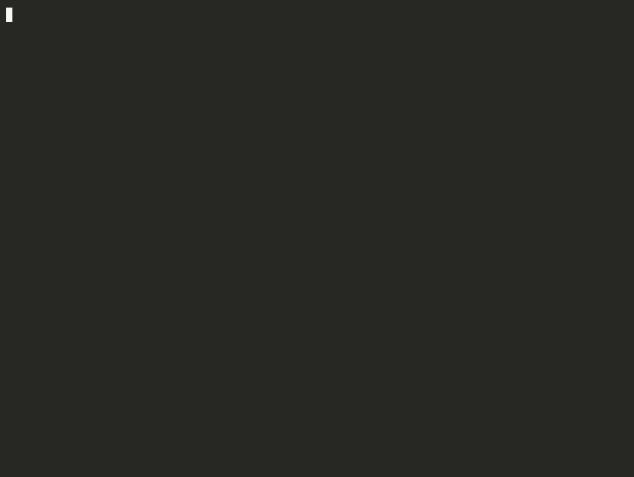
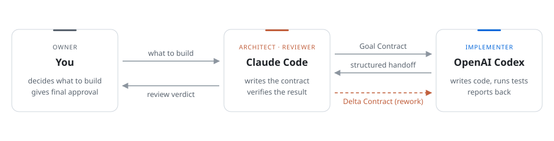
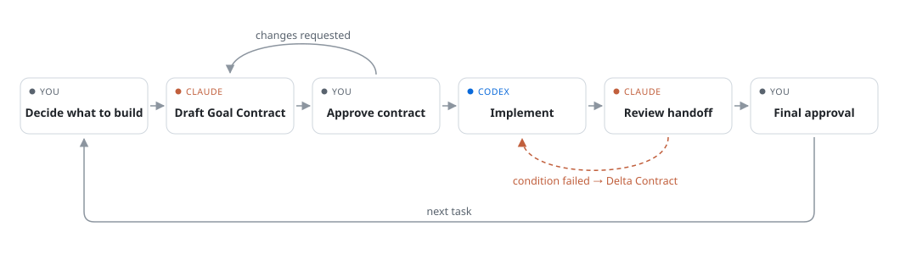

# claude2codex

An MCP server that lets Claude Code delegate implementation work to OpenAI Codex through structured contracts.

*[中文版](./README.zh-CN.md)*

## Demo

One real contract round-trip, recorded live: Claude drafts the Goal Contract, `codex_estimate` prices it, Codex implements under its goal loop while `codex_status` streams progress, and Claude independently re-verifies the handoff.



*Real Codex run (13k tokens, 50s), waits compressed. Replay in your terminal: `asciinema play demo/demo.cast`*

## Why

In 2025, AI-assisted coding meant writing detailed prompts that told the model *how* to implement things — which files to edit, what patterns to follow, sometimes nearly pseudocode. The engineer was a director; the AI was a typist that needed constant guidance.

That has changed. In 2026, models are [strong enough at implementation](https://www.anthropic.com/institute/recursive-self-improvement) that micromanaging the how is no longer the best use of a human's time. The bottleneck has shifted: when implementation is cheap, the expensive mistakes are **defining the wrong problem** and **failing to catch a bad result**. Getting the implementation steps right matters far less than getting the goal right.

This is why Goal Contracts are structured the way they are. They don't explain how to write the code — they define **what the code must do** (the Goal), **what to avoid** (Constraints), and **how to prove it worked** (Success Conditions). The engineer's role becomes problem definition, context provision, and verification — the same things that make a good engineering manager effective at delegation.

This project is built on that premise: split planning and review (where human judgment still dominates) from implementation (where models now excel), and connect them with a contract format that forces clarity on the parts that matter most.



- **You** — decide what to build and give final approval.
- **Claude Code** — the architect and reviewer. Defines the problem, writes the contract, verifies the result.
- **OpenAI Codex** — the implementer. Receives the contract, writes code, runs tests, reports back.

## What is a Goal Contract?

A Goal Contract is a structured specification that tells Codex *exactly* what to build. It has three parts:

| Section | Purpose |
|---------|---------|
| **Goal** | What the code must do when this task is done. |
| **Constraints** | Boundaries: which files to touch, patterns to follow, things *not* to modify. |
| **Success Conditions** | Checkable criteria that prove the goal is met. At least one must be a runnable test or command. |

Example:

```markdown
### Goal
Add a /health endpoint that returns 200 OK with the server version.

### Constraints
- Only modify src/routes.ts and src/routes.test.ts.
- Do not modify any existing endpoints.
- Follow the existing route registration pattern.

### Success Conditions
- [ ] GET /health returns 200 with JSON body {"version": "<package.json version>"}.
- [ ] `npm test` passes including a new test for the endpoint.
- [ ] `git diff --stat` lists only src/routes.ts and src/routes.test.ts.
```

**Why structure it this way?** Codex works best with unambiguous, verifiable instructions. Vague requests produce vague results. The contract format forces clarity: what to do, what not to do, and how to prove it worked.

For a deeper, field-tested guide — contract anatomy, verification tricks, review discipline, calibration numbers, and anti-patterns, all distilled from building this repo's own features through the bridge — see **[PATTERNS.md](./PATTERNS.md)**.

## What is a Delta Contract?

When Claude reviews Codex's output and finds problems, it doesn't start over — it sends a **Delta Contract** (a rework order) scoped to *only* what failed:

| Section | Purpose |
|---------|---------|
| **Findings** | What is wrong, with file/line references. |
| **Failed Conditions** | Which Success Conditions from the original contract did not pass. |

Codex resumes the same thread (keeping all context from the first attempt) and fixes only the identified issues.

## Full Workflow



## Three-Layer Prompt Architecture

The prompt Codex works from is assembled from three layers, but only two of them come from claude2codex:

1. **Protocol layer** (embedded in the MCP server) — universal rules: how to self-verify work, how to format the handoff, how to handle rework. These never change regardless of project.

2. **Project layer** (`AGENTS.md`) — project-specific coding conventions, toolchain instructions, architectural constraints. **Loaded by Codex itself, not by this server.** Codex discovers `AGENTS.md` files across the working directory's repository tree (plus `AGENTS.override.md`) and places them in its instructions layer, subject to its own `project_doc_max_bytes` budget. claude2codex used to inject the file a second time and no longer does.

3. **Task layer** (the Goal/Delta Contract itself) — the specific work to be done this time.

This separation means the MCP server works out of the box (layer 1 is always there), inherits whatever project context Codex already loads (layer 2), and carries the unique task specification (layer 3).

Note that the contract prompt and the **thread-goal objective** are different strings. The objective — rendered from `goal` plus every `success_condition` — is what Codex's `/goal` loop audits before declaring the goal achieved, and it has its own `GOAL_OBJECTIVE_MAX` budget. See [PATTERNS.md](PATTERNS.md#the-objective-budget-your-success-conditions-have-a-character-limit).

## Installation

Requires [Codex CLI](https://github.com/openai/codex) and Node.js 18+.

**Model & effort.** c2c uses whatever model and reasoning effort your Codex CLI is configured with (`~/.codex/config.toml`); it has no defaults of its own. Call `codex_config` to see what jobs will run with. To override, set `CODEX_MODEL` in the MCP server's `env` (all jobs) or pass `reasoning_effort` per job.

### MCP Configuration

Register the server with Claude Code (user scope, so every project gets it):

```sh
claude mcp add --scope user codex -- npx -y claude2codex
```

Or add it to your MCP settings by hand:

```json
{
  "mcpServers": {
    "codex": {
      "command": "npx",
      "args": ["-y", "claude2codex"]
    }
  }
}
```

### Workflow: Instructions + Prompt

The workflow reaches Claude in two layers. Neither needs extra installation.

- **Server instructions (automatic).** On connect, the server sends a short instruction block (under 1,000 chars) that Claude Code adds to its system prompt. It activates only when you ask to delegate work to Codex: Claude then drafts a Goal Contract for your approval, estimates, implements, polls, and re-runs verification itself. Tasks you don't delegate are handled as usual.
- **`c2c-workflow` Prompt (opt-in, full rules).** Goal/Delta Contract formats and the complete review protocol, including falsifiability checks. MCP Prompts are user-invoked: type `/mcp__codex__c2c-workflow` at the start of a delegating session (the middle segment is whatever you named the server in your MCP config).

### Project Setup: CLAUDE.md and AGENTS.md

The MCP server handles the workflow protocol. Your project files only need to carry **project-specific context** — don't repeat what the server already provides.

To see exactly what the server already provides, read the verbatim prompts (generated from the code, so they never drift):

- **[What Claude sees](https://github.com/PrestoOverture/c2c/blob/main/prompts/what-claude-sees.md)** — server instructions, the `c2c-workflow` Prompt, and tool descriptions. Read before writing `CLAUDE.md`.
- **[What Codex sees](https://github.com/PrestoOverture/c2c/blob/main/prompts/what-codex-sees.md)** — the protocol, rendered Goal/Delta Contracts, and the thread-goal objective. Read before writing `AGENTS.md`.

**`CLAUDE.md`** (for Claude — the architect/reviewer):

```markdown
# Claude Code Guidelines

The contract workflow is delivered by the MCP Prompt `c2c-workflow`.

## Session Startup
Read README.md and docs/design.md at session start.

## Review Additions
- Flag security issues (OWASP top 10).
- Run integration tests against staging after each task.

## Constraints
- Do not modify migrations without explicit approval.
```

**`AGENTS.md`** (for Codex — the implementer):

```markdown
# Codex Guidelines

You are the implementer. The contract protocol is delivered by the c2c bridge.

## Toolchain
Python 3.12, Poetry. Run from project root.
- `poetry run pytest` — test suite
- `poetry run ruff check .` — lint
- `poetry run mypy .` — typecheck

## Boundaries
- Do not modify alembic migrations directly.
- Do not add runtime dependencies without a contract constraint.
```

**What goes where:**

| | MCP server | CLAUDE.md | AGENTS.md |
|---|---|---|---|
| Role definition | ✓ | — | — |
| Workflow steps | ✓ | — | — |
| Contract formats | ✓ | — | — |
| Review protocol | ✓ | — | — |
| Session startup | — | ✓ | ✓ |
| Project-specific review rules | — | ✓ | — |
| Toolchain & build commands | — | — | ✓ |
| File/dependency boundaries | — | — | ✓ |

## Tools Provided

| Tool | Description |
|------|-------------|
| `codex_implement` | Start a Codex job from a Goal Contract. Supports `context_files` (read-first references, validated to exist), `verify_commands` / `setup_commands`, `test_paths` / `scope`, and `depends_on` (start only after a prior job succeeds). Returns a job ID immediately. |
| `codex_status` | Check job progress: state, queue position, dependency, turns, goal status, token usage, time since last activity, transcript, and server verification `evidence`. |
| `codex_result` | Fetch the finished job's structured handoff and server verification `evidence`. Read evidence first; review judges intent. |
| `codex_rework` | Resume the Codex thread with a Delta Contract (also accepts `context_files`, `verify_commands`, `setup_commands`, `test_paths`, and `scope`). Inherits both command lists and pathspec lists from `job_id` unless overridden; `[]` clears a list. |
| `codex_estimate` | Read-only pre-job cost estimate: rendered-prompt size (including `verify_commands`, `setup_commands`, `test_paths`, and `scope`), thread-goal objective size against `GOAL_OBJECTIVE_MAX`, plus token statistics from your local completed jobs. |
| `codex_config` | Read-only view of Codex's current model, version, and settings. |

Jobs are persisted (`C2C_STATE_DIR`), so status, results, and rework survive server restarts. Jobs beyond the concurrency cap queue FIFO; a stall watchdog reports when a running job stops making progress. See [PATTERNS.md](./PATTERNS.md) for field-tested guidance on writing contracts that pass review on the first try.

Pass `isolation: "worktree"` to `codex_implement` to run Codex in a persistent `<C2C_STATE_DIR>/worktrees/<job_id>` on branch `c2c/<job_id>`, created at the repository's HEAD when the job starts. A cwd inside a repo subdirectory maps to the same subdirectory in the worktree. The source working tree stays untouched; its staged, unstaged and untracked changes are excluded, and `source_dirty` reports whether it had uncommitted changes at start. Worktree or branch creation errors fail the job with the git diagnostic. Outside git, execution falls back to `in_place` with a note. Without this option, execution, records and outputs keep their existing behavior with no isolation metadata.

`codex_status` and `codex_result` expose `isolation: { mode, worktree_path, branch, base_commit, source_dirty, note }` for opted-in jobs. `codex_rework` by job ID or a known thread ID reuses the same worktree, branch, recorded base and execution directory, including after server restart; an explicit rework cwd does not override it. A missing isolated worktree is rejected at submission. Evidence snapshots come from the isolated worktree and compare against the recorded base commit, so committed worker changes remain in `evidence.changes` and falsification. Worktrees and branches persist; automatic merging and worktree cleanup are not provided.

Pass optional `verify_commands: string[]` to `codex_implement`: after Codex exits, the server runs each shell command (`sh -c`, server environment) in a temporary detached worktree containing tracked edits and untracked non-ignored files. Ignored files are absent; use optional `setup_commands: string[]` to install dependencies first in the same snapshot. Setup stops at its first failure; all verification commands run. Outside git, commands run in place. The job stays `running` and holds its slot until evidence is saved, then becomes `done` even if checks fail. Evidence records the environment, base commit, pass/fail, exit codes, timeouts, durations, and the last 4000 characters of combined output per command. Without verification commands, evidence is `null` and neither setup nor verification runs.

Declare optional `test_paths: string[]` and `scope: string[]` as Git glob pathspecs relative to the job cwd (for example, `test_paths: ["test/**/*.test.ts"]`, `scope: ["src/**"]`). Test classification uses only `test_paths`; put new tests under those paths. In worktrees, `evidence.changes` lists repo-root-relative `files` with added/modified/deleted status and test/production class, `tests_modified` (pre-existing tests edited or deleted), `out_of_scope` (changes outside both declarations, only when scope is given), and `new_unclassified` (added files matching neither declaration). Without test_paths, all changes are production; without scope, out_of_scope is empty.

After verification passes, with non-empty test_paths and production changes, the server builds a second snapshot of HEAD (the recorded base commit for isolated jobs) plus only the declared test changes, including additions and deletions. It runs setup again, then the same verification commands with the same per-command timeout. `evidence.falsification` records `ran`, `skipped_reason` when skipped or setup fails, `setup`, `commands` with `still_passes`, and `unfalsified` commands that still pass after reverting production changes. Review these flags: they never change evidence.passed or job state. Both temporary evidence snapshots are removed and pruned; verification leaves the source tree, index, HEAD and branches untouched and retains the job's isolated worktree. Rework inherits test_paths and scope unless overridden; `[]` clears a declaration.

## How the Goal Loop Works

Under the hood, each job:

1. Spawns a `codex app-server` process (Codex's JSON-RPC interface)
2. Starts (or resumes) a persisted thread
3. Sets a **thread goal** — the programmatic equivalent of Codex's `/goal` command
4. Sends the full contract as input

Codex then enters its goal-continuation loop: after each turn, it checks "did I achieve the goal?" If not, it keeps going. The job finishes when the goal reaches a terminal state (`complete` or `budget_limited`) or the thread goes quiet.

A job is cut off only when Codex stops producing events for `C2C_IDLE_TIMEOUT_MS` (20 min by default) or the whole job passes the `CODEX_JOB_TIMEOUT_MS` hard cap (2 h). A long job that keeps working is not killed.

## Environment Variables

| Variable | Default | Description |
|----------|---------|-------------|
| `CODEX_BIN` | `codex` | Codex executable to launch |
| `CODEX_ARGS` | `app-server` | Space-separated Codex arguments |
| `CODEX_CWD` | Current directory | Default working directory for jobs |
| `CODEX_MODEL` | Codex default | Model override |
| `CODEX_APPROVAL_POLICY` | `never` | Approval policy (autonomous by default) |
| `CODEX_PERMISSIONS` | Unset | Permissions profile passed to Codex |
| `CODEX_JOB_TIMEOUT_MS` | `7200000` | Overall maximum job duration (2 hours) |
| `C2C_VERIFY_TIMEOUT_MS` | `600000` | Per setup/verification command timeout (10 minutes), killing its process group. Codex job/idle/stall timers stop before server verification |
| `C2C_IDLE_TIMEOUT_MS` | `1200000` | Timeout after no Codex notifications during a running attempt (20 min); `0` disables. Queued/dependency wait time excluded |
| `CODEX_QUIET_MS` | `30000` | Quiet period before treating an active goal as finished |
| `GOAL_OBJECTIVE_MAX` | `2000` | Maximum rendered goal-objective length; `codex_implement` rejects over-limit contracts at submit time |
| `C2C_STATE_DIR` | `~/.claude2codex/jobs` | Persistent job registry (atomic per-job JSON files), append-only `outcomes.jsonl`, and opt-in job `worktrees/` |
| `C2C_MAX_JOBS` | `500` | Maximum retained job records (minimum 1); does not prune outcome history |
| `C2C_LOG_LEVEL` | `info` | Structured JSON logs on stderr: `silent`, `error`, `info`, `debug` |
| `C2C_RETRIES` | `1` | Automatic retries for process failures before the first turn starts |
| `C2C_MAX_CONCURRENT` | `2` | Max simultaneously active Codex jobs; overflow queues FIFO |
| `C2C_STALL_WARN_MS` | `120000` | Stall watchdog threshold; emits stalled/resumed events; `0` disables |

Each finished job appends one summary to `C2C_STATE_DIR/outcomes.jsonl` (mode `0600`), including rework lineage, usage, evidence summaries and the sorted `caught_by` checks. The log contains no prompts, transcripts or command output and survives job pruning; `C2C_MAX_JOBS` controls only job-record retention. Persistence failures degrade gracefully with at most one warning.

Opted-in jobs also log `isolation` (the mode) and `branch`. Job-record retention does not remove persistent worktrees or their branches.

## No Codex? Use c2c-lite

If Codex is unavailable (subscription expired, API down, rate limited), **[c2c-lite](https://github.com/PrestoOverture/c2c-lite)** gives you the same contract workflow with zero dependencies — Claude delegates to a Claude subagent instead of Codex, using the built-in `Agent` tool. Same Goal/Delta Contract format, same review discipline, no MCP server needed. Just one Skill file.

## Relationship to codex-plugin-cc

OpenAI maintains an official [Codex plugin for Claude Code](https://github.com/openai/codex-plugin-cc) (`codex-plugin-cc`). The two projects are **complementary, not competing** — they serve different workflows and can coexist in the same environment.

| | claude2codex | codex-plugin-cc |
|---|---|---|
| **Integration** | MCP server | Claude Code plugin |
| **Delegation model** | Structured Goal/Delta Contracts with mandatory handoff format | Free-form prompts forwarded to Codex as-is |
| **Review cycle** | Claude reviews Codex's output against success conditions; failures trigger scoped Delta Contracts | No structured review loop; results returned verbatim |
| **Code review** | Not included | Codex reviews Claude's code (native + adversarial) |
| **Concurrency** | Parallel jobs with FIFO queue and dependency chaining | Single task at a time |
| **Observability** | Token tracking, cost estimation, stall watchdog | Basic job status |

**When to use which:**

- **claude2codex** — when you want contract discipline: clearly defined goals, machine-checkable success conditions, structured handoffs, and a rework loop that converges on failures. Best for substantial implementation tasks where getting the specification right matters more than getting started fast.
- **codex-plugin-cc** — when you want quick Codex access: ad-hoc code reviews, fast rescue runs, session transfers between Claude and Codex. Best for lightweight delegation and review workflows.

Both use `codex app-server` under the hood. Installing one does not interfere with the other.

## Development

```sh
cd mcp
bun install
bun test          # e2e tests against a mock codex (no real API calls)
npm run build     # produces dist/server.js
```

## License

MIT
