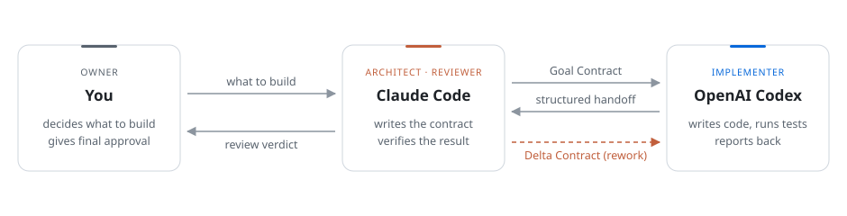
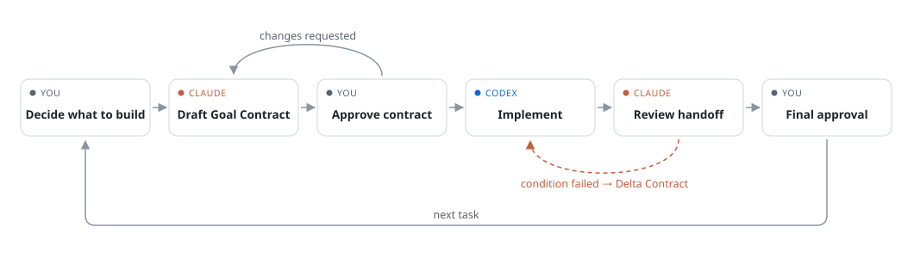
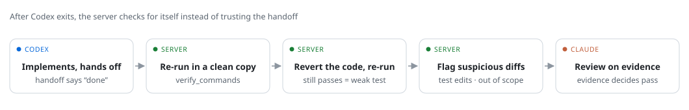
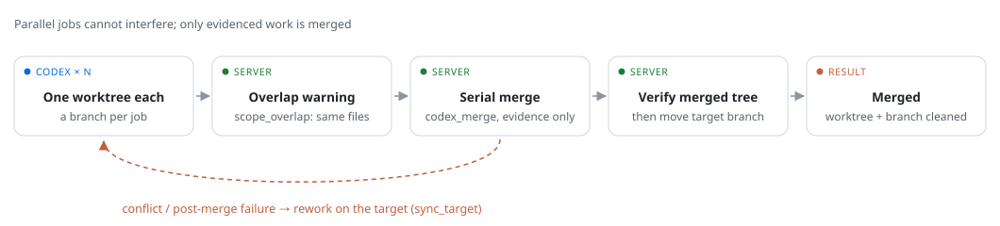

# claude2codex

An MCP server that lets Claude Code delegate implementation work to OpenAI Codex through structured contracts. Codex saying "done" is not enough: the server re-runs verification itself and reports evidence.

*[中文版](./README.zh-CN.md)*

## Demo

One real contract round-trip, recorded live: Claude drafts the Goal Contract, `codex_estimate` prices it, Codex implements under its goal loop while `codex_status` streams progress, and Claude independently re-verifies the handoff.


*Real Codex run (13k tokens, 50s), waits compressed. Replay in your terminal: `asciinema play demo/demo.cast`*

## Why

In 2025, AI-assisted coding meant writing detailed prompts that told the model *how* to implement things — which files to edit, what patterns to follow, sometimes nearly pseudocode. The engineer was a director; the AI was a typist that needed constant guidance.

In 2026, models are [strong enough at implementation](https://www.anthropic.com/institute/recursive-self-improvement) that micromanaging the how is no longer the best use of a human's time. When implementation is cheap, the expensive mistakes are **defining the wrong problem** and **failing to catch a bad result**.

So a Goal Contract doesn't explain how to write the code. It defines **what the code must do** (Goal), **what to avoid** (Constraints), and **how to prove it worked** (Success Conditions). The engineer's role becomes problem definition, context, and verification.



- **You** — decide what to build and give final approval.
- **Claude Code** — the architect and reviewer. Defines the problem, writes the contract, verifies the result.
- **OpenAI Codex** — the implementer. Receives the contract, writes code, runs tests, reports back.

## What is a Goal Contract?

| Section | Purpose |
| --- | --- |
| **Goal** | What the code must do when this task is done. |
| **Constraints** | Boundaries: which files to touch, things *not* to modify. |
| **Success Conditions** | Checkable criteria. At least one must be a runnable test or command. |

```markdown
### Goal
Add a /health endpoint that returns 200 OK with the server version.

### Constraints
- Only modify src/routes.ts and src/routes.test.ts.
- Do not modify any existing endpoints.

### Success Conditions
- [ ] GET /health returns 200 with JSON body {"version": "<package.json version>"}.
- [ ] `npm test` passes including a new test for the endpoint.
```

Vague requests produce vague results. The contract forces clarity: what to do, what not to do, and how to prove it worked. Field-tested guide (contract anatomy, verification tricks, review discipline, anti-patterns): **[PATTERNS.md](./PATTERNS.md)**.

## What is a Delta Contract?

When review finds problems, Claude doesn't start over. It sends a rework order scoped to only what failed:

| Section | Purpose |
| --- | --- |
| **Findings** | What is wrong, with file/line references. |
| **Failed Conditions** | Which Success Conditions did not pass. |

Codex resumes the same thread (keeping all context from the first attempt) and fixes only the identified issues.

## Full Workflow



## Server Evidence: Don't Trust the Handoff



- **Re-run verification**: pass `verify_commands`, and after Codex exits the server runs them itself in a clean temporary copy. That result decides pass or fail, whatever the handoff claims.
- **Falsification check**: declare `test_paths`, and the server reverts the implementation, keeps only the tests, and runs again. A check that still passes isn't testing the new behaviour.
- **Suspicious changes**: declare `scope`, and edits to existing tests, changes outside scope, and unclassified new files are flagged.
- Every finished job appends a line to `outcomes.jsonl`: rework rounds, which check caught what, tokens used.

## Parallel Jobs: Isolation and Merge



- **Own worktree**: pass `isolation: "worktree"` to `codex_implement` and the job works on its own branch and copy, leaving your working tree alone. Without it, jobs run in place as before.
- **Overlap warning**: when two unmerged jobs plan to change the same file, `scope_overlap` in `codex_status` / `codex_result` lists it. Advisory only.
- **Safe merge**: `codex_merge` merges one job at a time, only with passing evidence, and verifies the merged result before moving the target branch.
- **Conflict rework**: on a conflict or a failed post-merge check, call `codex_rework` with `sync_target: true`; Codex merges the target in, resolves, and you merge again.

## Tools

| Tool | What it does |
| --- | --- |
| `codex_implement` | Start a Codex job from a Goal Contract; returns a job ID immediately. |
| `codex_status` | Progress: state, queue position, token usage, recent activity, evidence. |
| `codex_result` | The finished job's handoff report and server evidence. |
| `codex_rework` | Send a Delta Contract to the same thread. |
| `codex_merge` | Merge an isolated job into its target branch, or discard it. |
| `codex_estimate` | Estimate prompt size and token cost before starting. |
| `codex_config` | Show the model and configuration Codex will use. |

Every parameter and returned field is documented in the generated **[What Claude sees](https://github.com/PrestoOverture/c2c/blob/main/prompts/what-claude-sees.md)** (identical to what the server sends Claude).

Jobs persist to disk (`C2C_STATE_DIR`), so status, results and rework survive a server restart. Jobs over the concurrency limit queue in order, and a watchdog reports jobs that stop making progress.

## Installation

Requires [Codex CLI](https://github.com/openai/codex) and Node.js 18+.

```sh
claude mcp add --scope user codex -- npx -y claude2codex
```

> **Note:** the latest npm release, 0.3.7, **does not yet include** server evidence or isolation and merge. To use them, run from source (requires [Bun](https://bun.sh)):
>
> ```sh
> git clone https://github.com/PrestoOverture/c2c.git
> cd c2c/mcp && bun install
> claude mcp add --scope user codex -- bun "$PWD/src/server.ts"
> ```

**Model & effort.** c2c uses your Codex CLI configuration (`~/.codex/config.toml`) and has no defaults of its own. `codex_config` shows what jobs will run with; to override, set `CODEX_MODEL` in the MCP server's `env` or pass `reasoning_effort` per job.

### How the workflow reaches Claude

- **Server instructions (automatic)**: added to Claude's system prompt on connect; active only when you ask to delegate to Codex.
- **`c2c-workflow` Prompt (opt-in)**: the full contract formats and review rules. Type `/mcp__codex__c2c-workflow` at the start of a session.

### Project setup: CLAUDE.md and AGENTS.md

The server carries the workflow rules; your project files only carry **project-specific context**:

| | MCP server | CLAUDE.md | AGENTS.md |
| --- | --- | --- | --- |
| Roles, workflow, contract formats, review protocol | ✓ | — | — |
| Files to read at session start | — | ✓ | ✓ |
| Project-specific review rules | — | ✓ | — |
| Toolchain, build commands, file/dependency boundaries | — | — | ✓ |

Before writing them, read what the server already sends: [What Claude sees](https://github.com/PrestoOverture/c2c/blob/main/prompts/what-claude-sees.md) (before `CLAUDE.md`) and [What Codex sees](https://github.com/PrestoOverture/c2c/blob/main/prompts/what-codex-sees.md) (before `AGENTS.md`).

<details>
<summary>Example CLAUDE.md and AGENTS.md</summary>

`CLAUDE.md` (for Claude — the architect/reviewer):

```markdown
# Claude Code Guidelines

The contract workflow is delivered by the MCP Prompt `c2c-workflow`.

## Session Startup
Read README.md and docs/design.md at the start.

## Review Additions
- Flag security issues (OWASP top 10).

## Constraints
- Never modify migrations without explicit approval.
```

`AGENTS.md` (for Codex — the implementer):

```markdown
# Codex Guidelines

You are the implementer. The contract protocol is provided by the c2c bridge.

## Toolchain
Python 3.12, Poetry.
- `poetry run pytest` — tests
- `poetry run ruff check .` — lint

## Boundaries
- Do not add runtime dependencies unless the contract says so.
```

</details>

## How It Works

Each job starts a `codex app-server` process, creates (or resumes) a thread, sets a **thread goal** (the programmatic `/goal`), and sends the contract. After every turn Codex asks itself "is the goal met?" and keeps going until it is complete or the budget runs out.

The prompt Codex works from has three layers: c2c's built-in **protocol** (how to self-verify and write the handoff), the **project** layer Codex loads itself (`AGENTS.md`), and the **contract** for this task.

A job is stopped only after 20 minutes with no Codex activity, or 2 hours in total; long jobs that keep working are not killed.

<details>
<summary>Environment variables</summary>

| Variable | Default | Description |
| --- | --- | --- |
| `CODEX_BIN` | `codex` | Codex executable |
| `CODEX_ARGS` | `app-server` | Codex launch arguments |
| `CODEX_CWD` | current directory | Default job working directory |
| `CODEX_MODEL` | Codex default | Model override |
| `CODEX_APPROVAL_POLICY` | `never` | Approval policy (autonomous by default) |
| `CODEX_PERMISSIONS` | unset | Permissions passthrough |
| `CODEX_JOB_TIMEOUT_MS` | `7200000` | Hard cap per job (2 h) |
| `C2C_IDLE_TIMEOUT_MS` | `1200000` | Timeout after no activity (20 min); `0` disables |
| `C2C_VERIFY_TIMEOUT_MS` | `600000` | Timeout per verify command (10 min) |
| `CODEX_QUIET_MS` | `30000` | Quiet period before treating a goal as finished |
| `GOAL_OBJECTIVE_MAX` | `2000` | Max goal text length; longer contracts are rejected at submit |
| `C2C_STATE_DIR` | `~/.claude2codex/jobs` | Job records, `outcomes.jsonl`, and isolated worktrees |
| `C2C_MAX_JOBS` | `500` | Job records retained |
| `C2C_LOG_LEVEL` | `info` | Log level: `silent`, `error`, `info`, `debug` |
| `C2C_RETRIES` | `1` | Automatic retries when a job fails to start |
| `C2C_MAX_CONCURRENT` | `2` | Max jobs running at once; extras queue |
| `C2C_STALL_WARN_MS` | `120000` | Warn after this long without progress; `0` disables |

</details>

## No Codex? Use c2c-lite

If Codex is unavailable (subscription expired, API down, rate limited), **[c2c-lite](https://github.com/PrestoOverture/c2c-lite)** gives you the same contract workflow: Claude delegates to a Claude subagent instead (Sonnet recommended). No MCP server, just one Skill file.

## Relationship to codex-plugin-cc

OpenAI's official [Codex plugin for Claude Code](https://github.com/openai/codex-plugin-cc) is **complementary**; both can be installed together.

| | claude2codex | codex-plugin-cc |
| --- | --- | --- |
| **Delegation** | Structured Goal/Delta Contracts | Free-form prompts forwarded as-is |
| **Acceptance** | Server re-runs verification + falsification; Claude reviews against conditions; failures get scoped rework | Results returned verbatim |
| **Parallelism** | Parallel jobs, isolated worktrees, verified merge | One task at a time |
| **Code review** | Not included | Codex reviews Claude's code |

Use claude2codex for substantial tasks where the spec matters and results must be verifiable; use codex-plugin-cc for quick reviews and rescue runs.

## Development

```sh
cd mcp
bun install
bun test          # tests against a mock codex (no real API calls)
npm run build     # produces dist/server.js
```

## License

MIT
