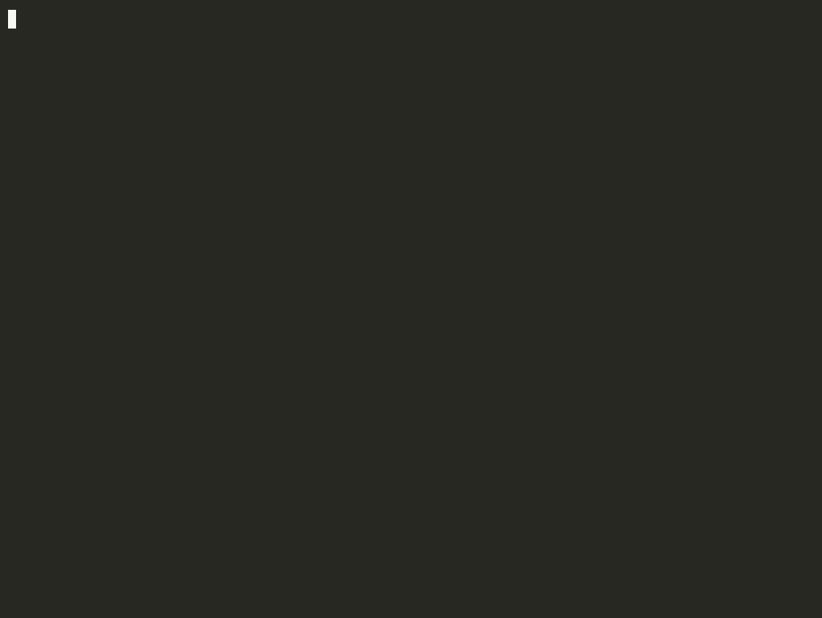
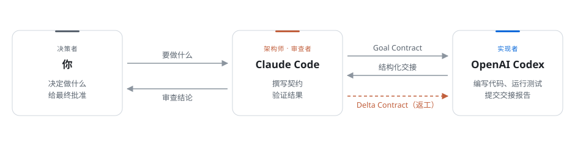
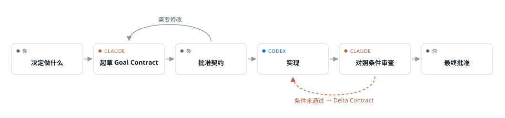
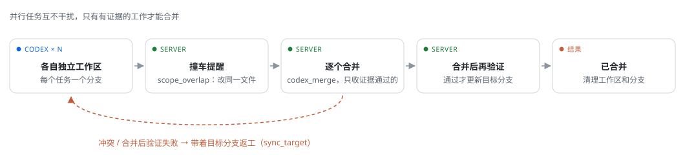

# claude2codex

一个让 Claude Code 通过结构化契约将实现工作委派给 OpenAI Codex 的 MCP 服务器。Codex 说"做完了"不算数，服务端自己重跑验证，拿证据说话。

*[English](./README.md)*

## 演示

完整的workflow实践过程：Claude 起草 Goal Contract，`codex_estimate` 预估成本，Codex 在 goal loop 下自主实现（`codex_status` 实时流式进度），最后 Claude 独立复核 handoff。



*Codex 运行（13k tokens，50 秒），等待时间已压缩。终端回放：*`asciinema play demo/demo.cast`

## 为什么做这个项目

2025 年，AI 辅助编程的主流方式是写详细的 prompt 告诉模型*怎么*实现——改哪些文件、用什么模式、有时候几乎是伪代码。工程师是导演，AI 是需要不断指导的执行者。

2026 年，模型的[实现能力已经足够强](https://www.anthropic.com/institute/recursive-self-improvement)，事无巨细地指挥"怎么写"不再是工程师最好的时间投入方式。瓶颈转移了：当实现变得廉价，真正昂贵的错误是**定义了错误的问题**和**没有验收出坏的结果**。

所以 Goal Contract 不解释怎么写代码——它定义**代码必须做到什么**（Goal）、**要避免什么**（Constraints）和**怎么证明做对了**（Success Conditions）。工程师的角色变成问题定义、上下文补充和验收。



- **你** — 定义问题，决定做什么，给最终批准。
- **Claude Code** — 架构师和审查者。辅助架构设计，撰写契约，验证结果。
- **OpenAI Codex** — 实现者。接收契约，编写代码，运行测试，报告结果。

## 什么是 Goal Contract（目标契约）？

| 部分 | 作用 |
| --- | --- |
| **Goal（目标）** | 任务完成后代码应该达到的状态。 |
| **Constraints（约束）** | 边界条件：该动哪些文件、哪些东西*不能*改。 |
| **Success Conditions（成功条件）** | 可验证的标准。至少一条必须是可运行的测试或命令。 |

```markdown
### Goal
添加一个 /health 端点，返回 200 OK 并包含服务器版本号。

### Constraints
- 只修改 src/routes.ts 和 src/routes.test.ts。
- 不修改任何已有端点。

### Success Conditions
- [ ] GET /health 返回 200，JSON body 为 {"version": "<package.json 版本>"}。
- [ ] `npm test` 通过，包含新端点的测试。
```

模糊的请求产生模糊的结果。契约格式强制你想清楚：做什么、不做什么、怎么证明做对了。实战指南（合同解剖、验证技巧、审查纪律、反模式）见 **[PATTERNS.zh-CN.md](./PATTERNS.zh-CN.md)**。

## 什么是 Delta Contract（差量契约）？

审查发现问题时不从头来过，而是发一份只针对失败部分的返工指令：

| 部分 | 作用 |
| --- | --- |
| **Findings（发现）** | 什么地方有问题，附文件/行号。 |
| **Failed Conditions（失败条件）** | 哪些 Success Conditions 没通过。 |

Codex 恢复同一个线程（保留第一次尝试的全部上下文），只修被指出的问题。

## 完整工作流



## 服务端证据：不信一面之词


- **重跑验证**：传入 `verify_commands`，Codex 退出后服务端在一份干净的临时副本里自己跑一遍。通过与否以这里为准，不看 Codex 怎么说。
- **证伪检查**：声明 `test_paths` 后，服务端把实现代码撤掉、只留测试再跑一次。如果还能通过，说明这个测试根本没在检查新功能。
- **可疑改动**：声明 `scope` 后，改了已有测试、改了范围外文件、新加了没归类的文件，都会被标出来。
- 每个任务结束都会在 `outcomes.jsonl` 记一行：返工了几轮、哪项检查抓到了问题、花了多少 token。

## 并行任务：隔离与合并



- **独立工作区**：给 `codex_implement` 传 `isolation: "worktree"`，任务就在自己的分支和副本里干活，不碰你的工作目录。不传则照旧在原地执行。
- **撞车提醒**：两个未合并的任务计划改同一个文件时，`codex_status` / `codex_result` 里的 `scope_overlap` 会列出来。只提醒，不拦截。
- **安全合并**：`codex_merge` 一次只合并一个任务，只收证据通过的，合并后再整体验证一次，通过了才更新目标分支。
- **冲突返工**：合并冲突或合并后验证失败时，用 `codex_rework` 加 `sync_target: true`，让 Codex 先把目标分支合进来、解决冲突，再重新合并。

## 提供的工具

| 工具 | 作用 |
| --- | --- |
| `codex_implement` | 用 Goal Contract 启动一个 Codex 任务，立即返回 job ID。 |
| `codex_status` | 查进度：状态、排队位置、token 用量、最近活动和证据。 |
| `codex_result` | 取已完成任务的交接报告和服务端证据。 |
| `codex_rework` | 用 Delta Contract 让同一个线程返工。 |
| `codex_merge` | 把隔离任务合并到目标分支，或丢弃它。 |
| `codex_estimate` | 开工前预估 prompt 大小和 token 成本。 |
| `codex_config` | 查看 Codex 当前用的模型和配置。 |

每个参数和返回字段的完整说明，见服务端自动生成的 **[What Claude sees](https://github.com/PrestoOverture/c2c/blob/main/prompts/what-claude-sees.md)**（英文，与实际发给 Claude 的内容一致）。

任务会持久化到磁盘（`C2C_STATE_DIR`），服务器重启后仍可查询和返工。超出并发上限的任务按顺序排队；任务卡住没进展时会主动提醒。

## 安装

需要 [Codex CLI](https://github.com/openai/codex) 和 Node.js 18+。

```sh
claude mcp add --scope user codex -- npx -y claude2codex
```

> **注意：** npm 上的最新版本是 0.3.7，**还不包含**上面的"服务端证据"和"隔离与合并"。想用这些功能，请从源码运行（需要 [Bun](https://bun.sh)）：
>
> ```sh
> git clone https://github.com/PrestoOverture/c2c.git
> cd c2c/mcp && bun install
> claude mcp add --scope user codex -- bun "$PWD/src/server.ts"
> ```

**模型与推理强度。** c2c 沿用 Codex CLI 的配置（`~/.codex/config.toml`），自身不设默认值。用 `codex_config` 查看实际会用的模型；要覆盖，可在 MCP 的 `env` 里设 `CODEX_MODEL`，或给单个任务传 `reasoning_effort`。

### 工作流怎么送到 Claude

- **服务器 instructions（自动）**：连接时自动加入 Claude 的系统提示，只在你要求交给 Codex 时生效。
- **`c2c-workflow` Prompt（按需）**：完整的契约格式和审查规则。在会话开头输入 `/mcp__codex__c2c-workflow` 调用。

### 项目配置：CLAUDE.md 和 AGENTS.md

工作流规则由服务器提供，项目文件里只放**项目特有的内容**：

| | MCP 服务器 | CLAUDE.md | AGENTS.md |
| --- | --- | --- | --- |
| 角色、工作流、契约格式、审查协议 | ✓ | — | — |
| 会话启动要读的文件 | — | ✓ | ✓ |
| 项目特有的审查规则 | — | ✓ | — |
| 工具链与构建命令、文件/依赖边界 | — | — | ✓ |

写之前可以先看服务器实际发了什么：[What Claude sees](https://github.com/PrestoOverture/c2c/blob/main/prompts/what-claude-sees.md)（写 `CLAUDE.md` 前读）、[What Codex sees](https://github.com/PrestoOverture/c2c/blob/main/prompts/what-codex-sees.md)（写 `AGENTS.md` 前读）。

<details>
<summary>示例 CLAUDE.md 和 AGENTS.md</summary>

`CLAUDE.md`（给 Claude——架构师/审查者）：

```markdown
# Claude Code Guidelines

契约工作流由 MCP Prompt `c2c-workflow` 提供。

## 会话启动
开始时阅读 README.md 和 docs/design.md。

## 审查补充
- 标记安全问题（OWASP top 10）。

## 约束
- 未经明确批准不得修改 migrations。
```

`AGENTS.md`（给 Codex——实现者）：

```markdown
# Codex Guidelines

你是实现者。契约协议由 c2c bridge 提供。

## 工具链
Python 3.12，Poetry。
- `poetry run pytest` — 测试
- `poetry run ruff check .` — 代码检查

## 边界
- 未经合同约束不得添加运行时依赖。
```

</details>

## 工作原理

每个任务会启动一个 `codex app-server` 进程，创建（或恢复）一个线程，设置 **thread goal**（相当于 Codex 里的 `/goal`），再把契约发过去。之后 Codex 每轮结束都自问"目标达成了吗"，没达成就继续，直到完成或预算用尽。

Codex 发给模型的 prompt 有三层：c2c 内置的**协议层**（怎么自检、怎么写交接）、Codex 自己加载的**项目层**（`AGENTS.md`）、以及这次的**契约本身**。

只有 Codex 连续 20 分钟没动静，或整个任务超过 2 小时，才会被中止；一直在干活的长任务不会被杀掉。

<details>
<summary>环境变量</summary>

| 变量 | 默认值 | 说明 |
| --- | --- | --- |
| `CODEX_BIN` | `codex` | Codex 可执行文件 |
| `CODEX_ARGS` | `app-server` | Codex 启动参数 |
| `CODEX_CWD` | 当前目录 | 任务默认工作目录 |
| `CODEX_MODEL` | Codex 默认 | 模型覆盖 |
| `CODEX_APPROVAL_POLICY` | `never` | 审批策略（默认自主执行） |
| `CODEX_PERMISSIONS` | 未设置 | 权限配置透传 |
| `CODEX_JOB_TIMEOUT_MS` | `7200000` | 单任务总时长上限（2 小时） |
| `C2C_IDLE_TIMEOUT_MS` | `1200000` | 无动静多久算超时（20 分钟），`0` 禁用 |
| `C2C_VERIFY_TIMEOUT_MS` | `600000` | 每条验证命令的超时（10 分钟） |
| `CODEX_QUIET_MS` | `30000` | 判定完成前的静默等待 |
| `GOAL_OBJECTIVE_MAX` | `2000` | 目标文本长度上限，超限的合同提交时被拒 |
| `C2C_STATE_DIR` | `~/.claude2codex/jobs` | 任务记录、`outcomes.jsonl` 和隔离工作区的位置 |
| `C2C_MAX_JOBS` | `500` | 保留的任务记录数 |
| `C2C_LOG_LEVEL` | `info` | 日志级别：`silent`、`error`、`info`、`debug` |
| `C2C_RETRIES` | `1` | 启动失败时的自动重试次数 |
| `C2C_MAX_CONCURRENT` | `2` | 同时运行的任务上限，超出排队 |
| `C2C_STALL_WARN_MS` | `120000` | 多久没进展就提醒卡住，`0` 禁用 |

</details>

## 没有 Codex？用 c2c-lite

Codex 不可用（欠费、API 故障、限流）时，**[c2c-lite](https://github.com/PrestoOverture/c2c-lite)** 提供同样的合同工作流：Claude 把活儿派给另一个 Claude 子代理（建议 Sonnet）。不需要 MCP 服务器，只要一个 Skill 文件。

## 与 codex-plugin-cc 的关系

OpenAI 官方的 [Codex plugin for Claude Code](https://github.com/openai/codex-plugin-cc) 与本项目**互补**，可以同时安装。

| | claude2codex | codex-plugin-cc |
| --- | --- | --- |
| **委派方式** | 结构化 Goal/Delta Contract | 自由文本 prompt 原样转发 |
| **验收** | 服务端重跑验证 + 证伪检查，Claude 按条件审查，失败则定向返工 | 结果原样返回 |
| **并行** | 并行任务、独立工作区、验证后合并 | 单任务 |
| **代码审查** | 不包含 | Codex 审查 Claude 的代码 |

需要把规格想清楚、要可验证结果的实质性任务，用 claude2codex；快速让 Codex 看一眼代码、救个急，用 codex-plugin-cc。

## 开发

```sh
cd mcp
bun install
bun test          # 测试（使用 mock，无需真实 API 调用）
npm run build     # 生成 dist/server.js
```

## 协议

MIT
