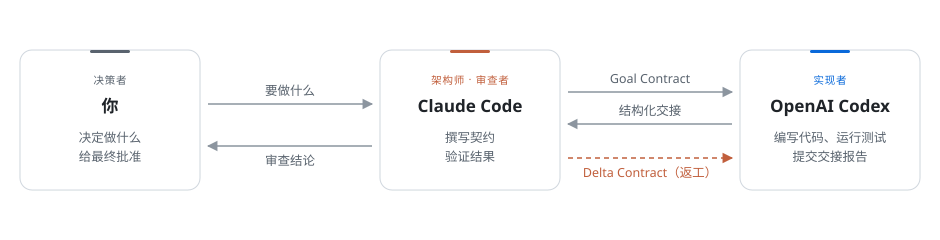
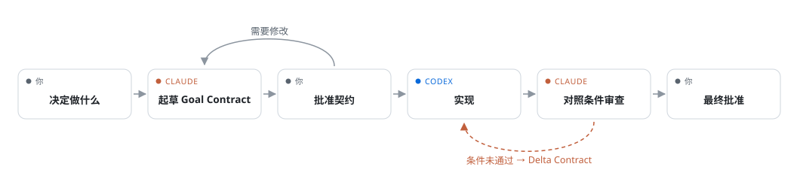

# claude2codex

一个让 Claude Code 通过结构化契约将实现工作委派给 OpenAI Codex 的 MCP 服务器。

*[English](./README.md)*

## 演示

完整的workflow实践过程：Claude 起草 Goal Contract，`codex_estimate` 预估成本，Codex 在 goal loop 下自主实现（`codex_status` 实时流式进度），最后 Claude 独立复核 handoff。


*Codex 运行（13k tokens，50 秒），等待时间已压缩。终端回放：*`asciinema play demo/demo.cast`

## 为什么做这个项目

2025 年，AI 辅助编程的主流方式是写详细的 prompt 告诉模型*怎么*实现——改哪些文件、用什么模式、有时候几乎是伪代码。工程师是导演，AI 是需要不断指导的执行者。

2026 年，模型的[实现能力已经足够强](https://www.anthropic.com/institute/recursive-self-improvement)，事无巨细地指挥"怎么写"不再是工程师最好的时间投入方式。瓶颈转移了：当实现变得廉价，真正昂贵的错误是**定义了错误的问题**和**没有验收出坏的结果**。把实现步骤写对，远不如把目标定义对重要。

这就是为什么 Goal Contract 被设计成这样。它不解释怎么写代码——它定义**代码必须做到什么**（Goal），**要避免什么**（Constraints）和**怎么证明做对了**（Success Conditions）。工程师的角色变成了问题定义、上下文补充和验收——和一个好的工程管理者委派任务时做的事情一样。

这个项目建立在这个前提上：把规划和审查（人的判断力仍然占主导）与实现（模型已经足够强）分开，用一种契约格式把它们连接起来，迫使工程师在最重要的部分(问题定义和验收标准)上做到清晰。




- **你** — 定义问题，决定做什么，给最终批准。
- **Claude Code** — 架构师和审查者。辅助架构设计，撰写契约，验证结果。
- **OpenAI Codex** — 实现者。接收契约，编写代码，运行测试，报告结果。


## 什么是 Goal Contract（目标契约）？

Goal Contract 是一份结构化规格说明，精确告诉 Codex **要做什么**。它由三部分组成：


| 部分                           | 作用                               |
| ---------------------------- | -------------------------------- |
| **Goal（目标）**                 | 任务完成后代码应该达到的状态。                  |
| **Constraints（约束）**          | 边界条件：该动哪些文件、遵循什么模式、哪些东西*不能*改。    |
| **Success Conditions（成功条件）** | 可验证的标准，证明目标已达成。至少一条必须是可运行的测试或命令。 |


示例：

```markdown
### Goal
添加一个 /health 端点，返回 200 OK 并包含服务器版本号。

### Constraints
- 只修改 src/routes.ts 和 src/routes.test.ts。
- 不修改任何已有端点。
- 遵循现有的路由注册模式。

### Success Conditions
- [ ] GET /health 返回 200，JSON body 为 {"version": "<package.json 版本>"}。
- [ ] `npm test` 通过，包含新端点的测试。
- [ ] `git diff --stat` 只列出 src/routes.ts 和 src/routes.test.ts。
```

**为什么要这样结构化？** Codex 在面对明确、可验证的指令时表现最佳。模糊的请求产生模糊的结果。契约格式强制你想清楚：做什么、不做什么、怎么证明做对了。

更深入的实战指南——合同解剖、验证技巧、审查纪律、校准数字、反模式，全部提炼自"用这座桥构建本仓库自身功能"的真实过程——参见 **[PATTERNS.zh-CN.md](./PATTERNS.zh-CN.md)**。

## 什么是 Delta Contract（差量契约）？

当 Claude 审查 Codex 的产出并发现问题时，不会从头来过 — 而是发送一份 **Delta Contract**（返工指令），只针对*失败的部分*：


| 部分                          | 作用                              |
| --------------------------- | ------------------------------- |
| **Findings（发现）**            | 什么地方有问题，附文件/行号引用。               |
| **Failed Conditions（失败条件）** | 原始契约中哪些 Success Conditions 没通过。 |


Codex 恢复同一个线程（保留第一次尝试的全部上下文），只修复被指出的问题。

## 完整工作流




## 三层 Prompt 架构

Codex 最终工作时的 prompt 由三层组成，但只有两层来自 claude2codex：

1. **协议层**（内嵌在 MCP 服务器中）— 通用规则：如何自我验证、如何格式化交接报告、如何处理返工。无论什么项目都一样。
2. **项目层**（`AGENTS.md`）— 项目特定的编码规范、工具链说明、架构约束。**由 Codex 自己加载，不是本服务器注入的。** Codex 会在工作目录所属的仓库树中查找 `AGENTS.md`（以及 `AGENTS.override.md`），放进它自己的 instructions 层，并受其 `project_doc_max_bytes` 预算约束。claude2codex 过去会重复注入一遍，现已移除。
3. **任务层**（Goal/Delta Contract 本身）— 这次要做的具体工作。

这种分离意味着：MCP 服务器开箱即用（第 1 层始终存在），直接继承 Codex 已经加载的项目上下文（第 2 层），每次任务都有独特的规格说明（第 3 层）。

注意：合同 prompt 和 **thread-goal objective** 是两个不同的字符串。objective 由 `goal` 加上每一条 `success_condition` 渲染而成，是 Codex `/goal` 循环在宣布目标达成前实际审查的对象，并有自己的 `GOAL_OBJECTIVE_MAX` 预算。详见 [PATTERNS.zh-CN.md](PATTERNS.zh-CN.md#objective-预算你的-success-conditions-有字符上限)。

## 安装

需要 [Codex CLI](https://github.com/openai/codex) 和 Node.js 18+。

**模型与推理强度。** c2c 直接沿用 Codex CLI 的配置（`~/.codex/config.toml`），自身不设任何默认值。调用 `codex_config` 可查看任务实际将使用的模型和强度。如需覆盖：在 MCP server 的 `env` 中设置 `CODEX_MODEL`（作用于所有任务），或在单个任务中传入 `reasoning_effort`。

### MCP 配置

在 Claude Code 中注册服务器（user 范围，所有项目都可用）：

```sh
claude mcp add --scope user codex -- npx -y claude2codex
```

或手动添加到 MCP 设置中：

```json
{
  "mcpServers": {
    "codex": {
      "command": "npx",
      "args": ["-y", "claude2codex"]
    }
  }
}
```


### 工作流：Instructions + Prompt

工作流分两层送达 Claude，都无需额外安装。

- **服务器 instructions（自动）。** 连接时服务器会发送一段简短说明（不超过 1000 字符），Claude Code 会把它加入系统提示。它只在你要求把工作交给 Codex 时生效：Claude 会起草 Goal Contract 供你批准，然后估算、提交、轮询，并亲自重跑验证命令。不委派的任务照常处理。
- **`c2c-workflow` Prompt（按需调用，完整规则）。** Goal/Delta Contract 格式和完整审查协议（含可证伪性检查）。MCP Prompt 需要用户手动调用：在要委派的 session 开头输入 `/mcp__codex__c2c-workflow`（中间一段是你在 MCP 配置里给服务器起的名字）。

### 项目配置：CLAUDE.md 和 [AGENTS.md](http://AGENTS.md)

MCP 服务器负责工作流协议。你的项目文件只需要放**项目特有的上下文**——不要重复服务器已经提供的内容。

服务器具体提供了哪些内容，可以直接看原文（由代码生成，与实际发送的内容始终一致，英文）：

- **[What Claude sees](https://github.com/PrestoOverture/c2c/blob/main/prompts/what-claude-sees.md)**：服务器 instructions、`c2c-workflow` Prompt 和工具描述。写 `CLAUDE.md` 之前先读这份。
- **[What Codex sees](https://github.com/PrestoOverture/c2c/blob/main/prompts/what-codex-sees.md)**：协议、渲染后的 Goal/Delta Contract 和 thread-goal objective。写 `AGENTS.md` 之前先读这份。

`CLAUDE.md`（给 Claude——架构师/审查者）：

```markdown
# Claude Code Guidelines

契约工作流由 MCP Prompt `c2c-workflow` 提供。

## 会话启动
开始时阅读 README.md 和 docs/design.md。

## 审查补充
- 标记安全问题（OWASP top 10）。
- 每个任务完成后跑一遍 staging 的集成测试。

## 约束
- 未经明确批准不得修改 migrations。
```

`AGENTS.md`（给 Codex——实现者）：

```markdown
# Codex Guidelines

你是实现者。契约协议由 c2c bridge 提供。

## 工具链
Python 3.12，Poetry。从项目根目录运行。
- `poetry run pytest` — 测试套件
- `poetry run ruff check .` — 代码检查
- `poetry run mypy .` — 类型检查

## 边界
- 不要直接修改 alembic migrations。
- 未经合同约束不得添加运行时依赖。
```

**什么放哪里：**


|           | MCP 服务器     | CLAUDE.md | AGENTS.md |
| --------- | ----------- | --------- | --------- |
| 角色定义      | ✓           | —         | —         |
| 工作流步骤     | ✓           | —         | —         |
| 契约格式      | ✓           | —         | —         |
| 审查协议      | ✓           | —         | —         |
| 会话启动      | —           | ✓         | ✓         |
| 项目特有的审查规则 | —           | ✓         | —         |
| 工具链与构建命令  | —           | —         | ✓         |
| 文件/依赖边界   | —           | —         | ✓         |


## 提供的工具


| 工具                | 说明                                                                                                    |
| ----------------- | ----------------------------------------------------------------------------------------------------- |
| `codex_implement` | 从 Goal Contract 启动一个 Codex 任务。支持 `context_files`（先读参考文件，校验存在性）、`verify_commands` / `setup_commands`、`test_paths` / `scope` 和 `depends_on`（前序任务成功后才启动）。立即返回 job ID。 |
| `codex_status`    | 查看任务进度：状态、队列位置、依赖、轮次、目标状态、token 用量、距上次活动的时间、活动记录及服务端验证 `evidence`。 |
| `codex_result`    | 获取已完成任务的结构化交接报告及服务端验证 `evidence`。先读 evidence，审查负责判断实现是否符合意图。 |
| `codex_merge`     | 串行合并同一隔离工作区谱系的最新任务到记录的目标分支；要求 evidence 和合并后验证均通过。`cleanup` 默认为 true；`discard: true` 直接删除工作区和分支，不合并。 |
| `codex_rework`    | 用 Delta Contract 恢复 Codex 线程进行返工（同样支持 `context_files`、`verify_commands`、`setup_commands`、`test_paths`、`scope`）。未覆盖时从 `job_id` 继承命令和路径列表；`[]` 清空对应列表。 |
| `codex_estimate`  | 只读的任务前成本预估：渲染后的 prompt 规模（包含 `verify_commands`、`setup_commands`、`test_paths` 和 `scope`）、thread-goal objective 相对 `GOAL_OBJECTIVE_MAX` 的规模，以及本机已完成任务的 token 统计。 |
| `codex_config`    | 只读查看 Codex 当前模型、版本和配置。                                                                                |


任务会持久化（`C2C_STATE_DIR`），因此状态查询、结果获取和返工在 server 重启后依然可用。超出并发上限的任务按 FIFO 排队；停滞看门狗会在运行中的任务失去进展时主动上报。关于如何写出"一次过审"的合同，参见实战指南 [PATTERNS.zh-CN.md](./PATTERNS.zh-CN.md)。

向 `codex_implement` 传入 `isolation: "worktree"`，即可在任务开始时，以仓库 HEAD 为基准创建分支 `c2c/<job_id>` 和持久化工作区 `<C2C_STATE_DIR>/worktrees/<job_id>`。隔离任务若通过 `depends_on` 依赖另一个隔离任务，则从依赖任务的分支 tip 创建分支，并继承其目标分支。仓库内的子目录 cwd 会映射到工作区中的同一子目录。源工作区保持不变，其暂存、未暂存和未跟踪改动均不带入；`source_dirty` 表示开始时源工作区是否有未提交改动。创建分支或工作区失败会使任务变为 error，并保留 git 错误信息。非 git 目录回退为 `in_place` 并附带说明。不传此选项时，执行方式、持久化记录和输出保持原有行为，不增加隔离元数据。

启用后，`codex_status` 和 `codex_result` 会返回 `isolation: { mode, worktree_path, branch, base_commit, target_branch, source_dirty, note }`。通过 job ID 或已知 thread ID 调用 `codex_rework`，包括 server 重启后，均复用原工作区、分支、基准 commit 和执行目录；返工中显式传入的 cwd 不会覆盖它。隔离工作区已不存在时，返工在提交时即被拒绝。验证快照取自该隔离工作区，并与记录的基准 commit 比较，因此 Codex 已提交的改动仍计入 `evidence.changes` 和证伪检查。收集 evidence 后，服务端将工作区内剩余的未被忽略的改动提交到任务分支（`--no-verify`，仓库缺少身份配置时使用 c2c 身份）。即使未提供验证命令也会提交，但合并仍要求 evidence 通过。`target_branch` 记录创建时源仓库检出的分支；detached 状态为 null。

调用 `codex_merge { job_id, cleanup?: boolean, discard?: boolean }` 可合并该工作区谱系的最新任务。要求任务为 `done`、工作区没有运行或等待的任务，且 `evidence.passed: true`。所有尝试串行执行：在目标分支当前 tip 的临时工作区中以 `--no-ff` 合并，在对应子目录重新运行 setup 和验证命令，通过后才快进目标分支。目标分支已检出时同步更新其工作区；未检出时使用带旧值校验的 ref 更新。结果为 `merged`、`conflict`（文件列表）、`verification_failed`（合并后 evidence）、`target_blocked`（目标移动、脏文件冲突或无目标分支）；前置条件不满足返回 `refused`。合并未成功时目标分支、源工作区和任务工作区保持不变；临时合并工作区总会删除并 prune。

合并成功后默认删除任务工作区和分支，`cleanup: false` 可保留。`discard: true` 不合并而直接删除，返回 `discarded`；不要求 evidence 通过（用于丢弃失败的工作），只要求工作区没有运行或等待的任务。合并期间及清理或丢弃后禁止返工。Status/result 返回实际尝试任务的最新 `merge` 记录；每次尝试（包括拒绝）追加 `kind: "merge"` outcome。若合并成功但清理失败，仍返回 `merged`，附带 `cleaned_up: false` 和错误信息。

可向 `codex_implement` 传入可选的 `verify_commands: string[]`：Codex 退出后，服务端在临时 detached worktree 中以 `sh -c` 和服务端环境逐条运行命令，快照包含已跟踪文件的改动及未被忽略的未跟踪文件。被 git 忽略的文件不会复制；可用 `setup_commands: string[]` 先在同一快照中安装依赖。Setup 首次失败即停止，验证命令则全部执行。非 git 目录直接原地运行。验证期间任务保持 `running` 并占用并发名额，evidence 保存后变为 `done`，即使检查失败也不变为 error。Evidence 记录环境、基准 commit、通过与否、退出码、超时、耗时及每条命令合并输出的最后 4000 个字符。未提供验证命令时 evidence 为 `null`，setup 和验证均不执行。

可选的 `test_paths: string[]` 和 `scope: string[]` 是相对于任务 cwd 的 Git glob pathspec，例如 `test_paths: ["test/**/*.test.ts"]`、`scope: ["src/**"]`。测试分类只依据 test_paths；新增测试也应放在这些路径下。在 worktree 中，`evidence.changes.files` 列出仓库根目录相对路径、added/modified/deleted 状态及 test/production 分类；`tests_modified` 标记已有测试的修改或删除，不含新增测试；`out_of_scope` 列出不匹配 scope 和 test_paths 的改动（仅在传入 scope 时）；`new_unclassified` 列出两个声明均不匹配的新增文件。没有 test_paths 时全部归为 production；没有 scope 时 out_of_scope 为空。

验证通过、test_paths 非空且存在生产文件改动时，服务端建立第二份快照：HEAD（隔离任务使用记录的基准 commit）加上声明的测试文件改动，保留测试的新增、修改和删除，撤销生产文件改动。服务端重新执行 setup 和相同的验证命令，使用相同的逐命令超时。`evidence.falsification` 记录 `ran`、跳过或 setup 失败时的 `skipped_reason`、`setup`、含 `still_passes` 的 `commands`，以及撤销生产改动后仍然通过的 `unfalsified` 命令。这些标记供复核使用，不改变 evidence.passed 或任务状态。两份临时验证快照都会移除并 prune；验证不修改源工作区、索引、HEAD 和分支，任务的隔离工作区仍然保留。返工未覆盖时继承 test_paths 和 scope；`[]` 清空对应声明。

## Goal Loop 的工作原理

底层实现中，每个任务会：

1. 启动一个 `codex app-server` 进程（Codex 的 JSON-RPC 接口）
2. 创建（或恢复）一个持久化线程
3. 设置一个 **thread goal** — 相当于 Codex TUI 中 `/goal` 命令的编程等价物
4. 将完整契约作为输入发送

之后 Codex 进入目标持续循环：每一轮结束后它会检查"目标达成了吗？"如果没有，就继续。任务在目标达到终态（`complete` 或 `budget_limited`）或线程沉默时结束。

只有当 Codex 连续 `C2C_IDLE_TIMEOUT_MS`（默认 20 分钟）没有任何事件，或整个任务超过 `CODEX_JOB_TIMEOUT_MS` 硬上限（2 小时）时，任务才会被中止。持续在干活的长任务不会被杀掉。

## 环境变量


| 变量                      | 默认值                    | 说明                                                        |
| ----------------------- | ---------------------- | --------------------------------------------------------- |
| `CODEX_BIN`             | `codex`                | Codex 可执行文件                                               |
| `CODEX_ARGS`            | `app-server`           | Codex 启动参数（空格分隔）                                          |
| `CODEX_CWD`             | 当前目录                   | 任务默认工作目录                                                  |
| `CODEX_MODEL`           | Codex 默认               | 模型覆盖                                                      |
| `CODEX_APPROVAL_POLICY` | `never`                | 审批策略（默认自主执行）                                              |
| `CODEX_PERMISSIONS`     | 未设置                    | 权限配置透传                                                    |
| `CODEX_JOB_TIMEOUT_MS`  | `7200000`              | 单任务总时长硬上限（2 小时） |
| `C2C_VERIFY_TIMEOUT_MS` | `600000` | 每条 setup/验证命令的超时（10 分钟），超时杀死整个进程组；服务端验证前停止 Codex 的任务、空闲和停滞计时器 |
| `C2C_IDLE_TIMEOUT_MS` | `1200000` | 运行中的尝试连续无 Codex 通知时超时（20 分钟），`0` 禁用；排队和等待依赖的时间不计入 |
| `CODEX_QUIET_MS`        | `30000`                | 判定活跃目标已完成前的静默等待时间                                         |
| `GOAL_OBJECTIVE_MAX`    | `2000`                 | 渲染后 goal-objective 的最大长度；超限的合同会被 `codex_implement` 在提交时拒绝 |
| `C2C_STATE_DIR`         | `~/.claude2codex/jobs` | 持久化任务注册表（每任务一个原子写入的 JSON 文件）、仅追加的 `outcomes.jsonl` 及可选的任务 `worktrees/` |
| `C2C_MAX_JOBS` | `500` | 保留的任务记录上限（最小为 1）；不裁剪结果日志 |
| `C2C_LOG_LEVEL`         | `info`                 | stderr 上的结构化 JSON 日志：`silent`、`error`、`info`、`debug`      |
| `C2C_RETRIES`           | `1`                    | 首个 turn 开始前的进程故障自动重试次数                                    |
| `C2C_MAX_CONCURRENT`    | `2`                    | 同时活跃的 Codex 任务上限；超出按 FIFO 排队                              |
| `C2C_STALL_WARN_MS`     | `120000`               | 停滞看门狗阈值；发出 stalled/resumed 事件；`0` 禁用                      |


每个结束的任务会向 `C2C_STATE_DIR/outcomes.jsonl` 追加一条摘要（权限 `0600`），包含返工链、用量、证据摘要和排序后的 `caught_by` 检查项。日志不包含提示词、转录或命令输出，且不受任务裁剪影响；`C2C_MAX_JOBS` 仅控制任务记录的保留数量。持久化失败时正常降级，最多警告一次。

启用隔离的任务还会记录 `isolation`（模式）和 `branch`。合并尝试另行追加 `kind: "merge"`，记录结果和合并后 evidence 摘要。任务记录裁剪不会删除持久化工作区或其分支。

## 没有 Codex？用 c2c-lite

Codex 不可用（欠费、API 故障、限流）的时候，**[c2c-lite](https://github.com/PrestoOverture/c2c-lite)** 提供同样的合同工作流，零依赖——Claude 把活儿派给另一个 Claude 子代理 (建议Sonnet)，用的是 Claude Code 内置的 `Agent` 工具。同样的 Goal/Delta Contract 格式，同样的审查流程，不需要 MCP 服务器，只要一个 Skill 文件。

## 与 codex-plugin-cc 的关系

OpenAI 维护了一个官方的 [Codex plugin for Claude Code](https://github.com/openai/codex-plugin-cc)（`codex-plugin-cc`）。两个项目**互补而非竞争**——它们服务于不同的工作流，可以在同一环境中共存。

| | claude2codex | codex-plugin-cc |
|---|---|---|
| **集成方式** | MCP 服务器 | Claude Code 插件 |
| **委派模型** | 结构化 Goal/Delta Contract，强制交接格式 | 自由文本 prompt 原样转发给 Codex |
| **审查循环** | Claude 按 success conditions 审查 Codex 产出；失败触发限定范围的 Delta Contract | 无结构化审查循环；结果原样返回 |
| **代码审查** | 不包含 | Codex 审查 Claude 的代码（原生 + 对抗式） |
| **并发** | 并行任务 + FIFO 队列 + 依赖链 | 单任务 |
| **可观测性** | Token 追踪、成本预估、停滞看门狗 | 基本任务状态 |

**何时用哪个：**

- **claude2codex** — 需要契约纪律时：清晰的目标定义、可机器验证的成功条件、结构化交接报告、以及针对失败项收敛的返工循环。适合需要把规格说明想清楚的实质性实现任务。
- **codex-plugin-cc** — 需要快速调用 Codex 时：即时代码审查、快速 rescue 任务、Claude 与 Codex 之间的会话转移。适合轻量级委派和审查场景。

两者底层都使用 `codex app-server`。安装其中一个不会影响另一个。

## 开发

```sh
cd mcp
bun install
bun test          # 端到端测试（使用 mock，无需真实 API 调用）
npm run build     # 生成 dist/server.js
```


## 协议

MIT
